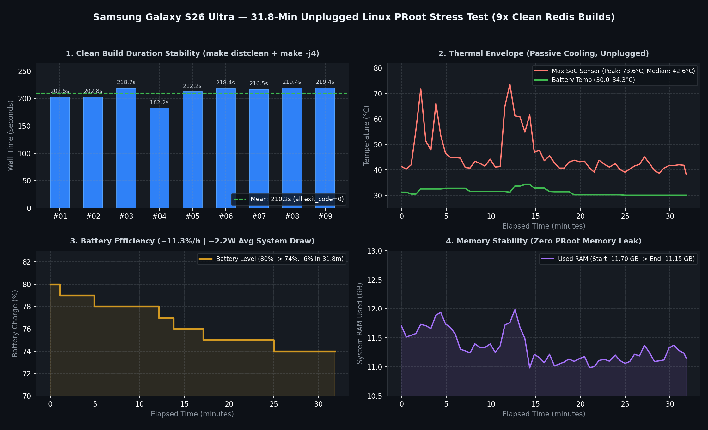

# Dex-Linux-Workstation

[](https://github.com/thecbr600/dex-linux-workstation/stargazers)
[](https://github.com/thecbr600/dex-linux-workstation/issues)
[](https://github.com/thecbr600/dex-linux-workstation/issues?q=is%3Aissue+is%3Aclosed)
[](https://github.com/thecbr600/dex-linux-workstation/blob/main/LICENSE)


A robust, low-latency Debian 13 (Trixie) desktop environment running natively on Android via Termux, PRoot, and Termux-X11. 

No VNC, no root required, and full audio support. Tested and optimized for modern flagship hardware (e.g., Samsung Galaxy S25/S26 Ultra, Galaxy Tab S10 Ultra), this project demonstrates a seamless, hardware-accelerated Linux desktop experience—achieving what the defunct official Linux on DeX project originally promised.

**Proof of Concept Video:** [Watch on YouTube](https://youtu.be/3X4EliaiAoY?is=9dkTdEM-_ZWulJTe)

---
[Compatibility List](COMPATIBILITY.md)

---
## Quick Start: Required Apps

Download and install the required APKs directly from the official GitHub releases:

- **Termux:** https://github.com/termux/termux-app/releases  
  Download `termux-app_...github-debug_arm64-v8a.apk` (recommended for modern Galaxy devices) or `..._universal.apk`.
- **Termux:X11:** https://github.com/termux/termux-x11/releases/tag/nightly  
  Download `termux-x11-universal-debug.apk`.
- **Termux:API *(optional, required for battery metrics in benchmarks)*:** https://github.com/termux/termux-api/releases  
  Download `termux-api-app_...github.debug.apk`.

> **Important:** Do **not** install Termux from the Google Play Store. The Play Store build is outdated and uses a different signing key, which prevents Termux from communicating with the GitHub builds of Termux:X11 and Termux:API.

---

## Quick Start (2-Step Modular Installation)

Run completely in user space via **Termux** (Ensure you installed Termux from F-Droid or GitHub Releases, *not* Google Play).

### Step 1: Base System Setup
Sets up a lean, low-latency Debian 13 (Trixie) XFCE desktop environment with native Termux-X11 rendering and synchronized PulseAudio TCP sound:

```bash
pkg update -y && pkg install curl -y && curl -sSL https://raw.githubusercontent.com/thecbr600/dex-linux-workstation/main/setup.sh | bash
```

### Step 2: Hardware GPU Acceleration Add-on (Universal)
Enables full 3D hardware acceleration via our automated VirGL/virpipe bridge. Automatically updates start scripts (`~/desktop` and `~/mobile`) and disables window compositing for tear-free 1440p/4K external display workflows:

```bash
curl -sSL https://raw.githubusercontent.com/thecbr600/dex-linux-workstation/main/addon/install-gpu.sh | bash
```

---

## Validated Hardware Architecture (Hardware-Agnostic GPU)

Unlike traditional setups relying strictly on Qualcomm Turnip/Zink drivers, this stack operates hardware-agnostically across different mobile GPU architectures via an optimized Android EGL/VirGL bridge.

| Metric | Qualcomm Snapdragon 8 Elite | MediaTek Dimensity 9300+ |
| :--- | :--- | :--- |
| **GPU Architecture** | Adreno 840 | ARM Immortalis-G720 MC12 |
| **Validated Device** | Samsung Galaxy S25/S26 Ultra | Samsung Galaxy Tab S10 Ultra |
| **glmark2 Score** | **186 FPS** (Uncapped) | **112 FPS** (120Hz Surface Sync) |
| **Average FrameTime** | ~5.0 ms | ~8.3 ms |
| **3D Engine Test** | Native 3D / Neverball / 1440p MPV | Native 3D / Stable TBDR Pipeline |

---

## Sustained Load Telemetry (32-Minute Soak Test)

To verify real-world thermal and memory stability without root or active cooling, the stack ran an unmanaged **31.8-minute continuous build workload** on a Samsung Galaxy S26 Ultra (unplugged, running on battery).



### Key Results

| Metric | Result | Notes |
| :--- | :--- | :--- |
| **Test Duration** | `31.8 min` | Continuous, unmanaged load in Debian 13 PRoot |
| **Build Consistency** | `9 / 9` | Clean Redis compilations from source (0 failures) |
| **Battery Temperature** | `30.0 °C – 34.3 °C` | Zero thermal throttling observed |
| **System Power Draw** | `~2.2 W` | Measured on battery (unplugged) |
| **Memory & Stability** | `0 LMK kills` | No Android Low Memory Killer events, no memory leaks |

### Reproducing the Benchmark

All raw telemetry logs, build timings, and plotting scripts are included in the repository:

```bash
bash benchmarks/soak_30m.sh---

## Crucial Step: Disable Android Child Process Restrictions

Starting with Android 12, Google enforces an aggressive **Phantom Process Killer** that limits background child processes to a maximum of 32. Heavy multitasking (multiple Chromium tabs, compilers, background services) will inevitably trigger this kill-switch if left unconfigured.

To ensure permanent container stability, disable this limit:

### Method 1: Developer Options (Recommended for One UI)
1. Navigate to **Settings** > **Developer options**.
2. Scroll to the **Apps** section.
3. Enable **Disable child process restrictions**.
4. Set the **Battery** usage for both **Termux** and **Termux-X11** to **Unrestricted**.

### Method 2: ADB Shell (One-time command)
If the toggle is not visible on your build, run this command once via ADB:

```bash
adb shell "/system/bin/device_config put activity_manager max_phantom_processes 2147483647"
adb shell settings put global settings_enable_monitor_phantom_procs false
```

---

## The Stack

* **OS Environment:** Android (Samsung One UI)
* **Container:** PRoot via `proot-distro`
* **Linux Distribution:** Debian 13 (Trixie) arm64
* **Display Protocol:** Termux-X11 / XFCE4
* **Audio Routing:** PulseAudio (TCP Module)

### Key Advantages Over Traditional Methods
* **Debian 13 (Trixie):** Built on the modern testing branch. Offers up-to-date packages and security standards, moving past the aging Debian 11/12 builds typically found in mobile setups.
* **Termux-X11 Display Server:** We bypass VNC completely. Termux-X11 renders directly using Android's native graphics layers, eliminating input lag and choppy frame rates.
* **PulseAudio TCP Bridge:** Sound works out-of-the-box via a local network bridge, allowing synchronized audio playback in browser and desktop apps.
* **Zero Root / Knox-Friendly:** Runs entirely in user space. Your device warranty remains intact and security mechanisms like Samsung Knox are completely untouched.

---

## Core Implementation Details

### 1. Audio Routing via TCP
To get native sound from the PRoot container to the Android host, we use a TCP bridge in Termux before booting the container:
```bash
pulseaudio --start --load="module-native-protocol-tcp auth-ip-acl=127.0.0.1 auth-anonymous=1" --exit-idle-time=-1
```
Inside Debian, the `PULSE_SERVER` environment variable is simply set to `127.0.0.1`.

### 2. Chromium Wrapper Script (Hardware & RAM Optimization)
Running Chromium in a PRoot container typically results in sandbox crashes or massive memory leaks. We utilize a custom wrapper located at `/usr/local/bin/chromium` to intercept the standard XFCE menu shortcut. This applies all necessary memory limits and display flags silently:

```bash
#!/bin/bash 
exec /usr/lib/chromium/chromium \
  --no-sandbox \
  --test-type \
  --disable-dev-shm-usage \
  --ozone-platform=x11 \
  --disable-gpu \
  --disable-software-rasterizer \
  --no-default-browser-check \
  --disable-background-networking \
  --disable-component-update \
  --disable-pings \
  --media-router=0 \
  --renderer-process-limit=2 \
  --js-flags="--max-old-space-size=512" \
  --disk-cache-size=1048576 \
  --media-cache-size=1048576 \
  "$@"
```
*Note: The `--test-type` flag suppresses the standard `--no-sandbox` yellow warning bar, keeping the UI entirely clean for daily driving.*

---

## Scope & Support Policy

This project is an opinionated proof-of-concept and deployment blueprint designed to demonstrate true desktop replacement capabilities on **modern flagship mobile hardware**. 

### Hardware Baseline
- **SoC:** Modern ARM64 flagship architecture (Snapdragon 8 Gen series, MediaTek Dimensity 9000 series, or equivalent).
- **RAM:** Minimum 12 GB (16 GB strongly recommended for multitasking).
- **Storage:** UFS 3.1 / UFS 4.0 storage (PRoot container performance scales heavily with random I/O).

### Non-Negotiable Support Boundaries
- **No Legacy / Budget Device Support:** We will not triage, optimize, or provide personal troubleshooting for low-tier, budget, or legacy hardware. Issues regarding performance drops on sub-spec hardware will be closed without debate.
- **Debian 13 (Trixie) Only:** This repository focuses strictly on a hardened, stable Debian baseline. Requests to port or debug alternate distributions (Ubuntu, Arch, Kali, etc.) are out of scope. If you want a different distro, feel free to fork the codebase.
- **Not a General Help Desk:** GitHub Issues are strictly reserved for reproducible bugs in the deployment script and environment architecture—not general Linux command-line tutoring.

---

## Contributing

Pull requests and technical discussions are explicitly encouraged around:
1. **Hardware-Accelerated Rendering (GPU):** Further optimizing `virglrenderer` bridges or reducing IPC overhead.
2. **PRoot Overhead Reduction:** Syscall filtering, seccomp optimizations, and native IO speedups.
3. **Background Storage Sync:** Native, low-overhead sync routines (e.g., automated `rclone bisync` daemon configurations).

Feel free to open issues or submit pull requests if you find ways to further push the boundaries of mobile workstation architecture.

## Empirical Verification & Benchmark

To prove workstation-grade POSIX compliance, dynamic linking, and multi-core scaling under sustained load, this stack compiles the full **Redis** codebase directly on-device using standard GNU toolchains.

### Benchmark Results (Snapdragon Flagship / PRoot Debian 13)

| Metric | Result | Note |
| :--- | :--- | :--- |
| **Real (Wall Clock)** | **3m 21.927s** | Complete build + link time |
| **User (CPU Time)** | **5m 41.676s** | Proof of multi-core scaling across performance cores |
| **Sys (Kernel Overhead)** | **0m 52.280s** | ~13% Syscall translation overhead (PRoot efficiency) |
| **Memory Integrity Test**| **PASSED** | 256 MB pattern allocation (`--test-memory 256`) |

<p align="center">
  
</p>

### Reproduce on Your Device

Inside your Debian container, verify basic dependencies:
```bash
apt update && apt install -y git build-essential make gcc

Run the official verification one-liner:

cd /tmp && rm -rf redis && git clone --depth 1 [https://github.com/redis/redis.git](https://github.com/redis/redis.git) && cd redis && echo "=== BUILD START ($(nproc) Cores) ===" && time make -j$(nproc) MALLOC=libc && ./src/redis-server --version && ./src/redis-server --test-memory 256 && echo "=== REDIS SUCCESSFULLY BUILT & VERIFIED ==="

```
```

## Optional Add-ons

Enhance your workstation with modular add-ons from the `addon/` directory. Run these one-liners after completing the main setup:

| Add-on | Description | One-Liner |
| :--- | :--- | :--- |
| **GPU Acceleration** | Enables hardware-accelerated OpenGL (VirGL) for smoother graphics | `curl -fsSL https://raw.githubusercontent.com/thecbr600/dex-linux-workstation/main/addon/install-gpu.sh \| bash` |
| **VS Code Server** | Installs browser-based VS Code (`code-server`) for local development | `curl -fsSL https://raw.githubusercontent.com/thecbr600/dex-linux-workstation/main/addon/install-code-server.sh \| bash` |
| **Super Key Mapping** | Maps the hardware Super/Meta key to open the XFCE app menu | `curl -fsSL https://raw.githubusercontent.com/thecbr600/dex-linux-workstation/main/addon/enable-super-key.sh \| bash` |
| **Home Screen Shortcuts** | Creates 1-tap `DeX Desktop` & `DeX Mobile` icons via `Termux:Widget` | `curl -fsSL https://raw.githubusercontent.com/thecbr600/dex-linux-workstation/main/addon/shortcuts.sh \| bash` |
| **Auto-Close X11** | Automatically closes `Termux:X11` and background services on XFCE logout | `curl -fsSL https://raw.githubusercontent.com/thecbr600/dex-linux-workstation/main/addon/autoclose.sh \| bash` |

> **Notes:**
> - Run `shortcuts.sh` and `autoclose.sh` in **native Termux** (if using `install-gpu.sh`, run `autoclose.sh` **last** so the logout hook isn't overwritten).
> - `shortcuts.sh` requires **Termux:Widget** from the same source as Termux (F-Droid or GitHub) and *"Display over other apps"* enabled for Termux.
